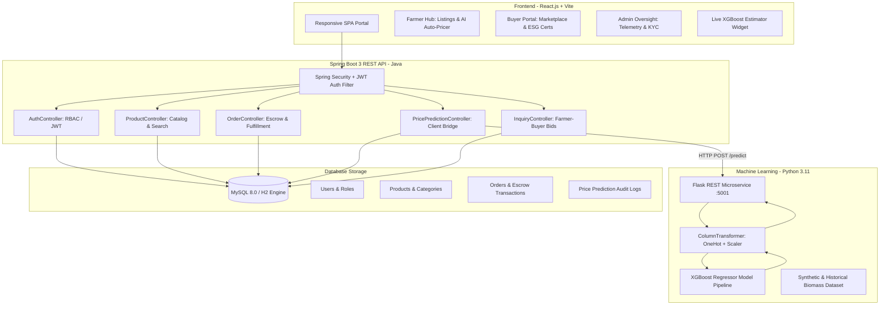

# 🌾 Agricultural By-Product Utilization & Exchange Platform
**React.js | Java 17+ | Spring Boot 3 | MySQL 8.0 | Python 3.11 | XGBoost**

> A full-stack enterprise circular economy platform connecting agricultural producers (farmers) and industrial consumers (biomass power plants, paper mills, 2G ethanol refiners, and bio-coal briquette manufacturers) for the exchange of agricultural by-products. The system features an **XGBoost machine learning price estimation engine** to prevent distress sales, an **escrow transaction system**, and **role-based portals** for Farmers, Buyers, and Platform Administrators.

---

## 🏛️ System Architecture



---

## 🚀 Key Features

### 1. 🌾 Farmer Empowerment & Inventory Hub
- **AI-Guided Listing**: Farmers input biomass type, lab-tested moisture content, and volume. The platform queries the **XGBoost engine** to calculate fair market price per metric ton before listing.
- **Inventory Tracking**: Manage active, reserved, and dispatched lots.
- **Direct Buyer Negotiations**: Review and counter bids submitted by factories and biomass aggregators.
- **Safe Escrow Payouts**: Guaranteed payments held in escrow and released immediately upon verified physical delivery.

### 2. 🏭 Industrial Buyer Procurement Portal
- **Marketplace Discovery**: Filter agricultural residues by type (rice straw, wheat straw, sugarcane bagasse, corn cobs, coir pith, cotton stalks), max moisture %, state, and price.
- **Fair Value Verification**: Compare listed price against the **XGBoost AI Benchmark** to ensure transparent market rates.
- **Escrow-Guarded Checkout**: Lock funds in escrow with automatic breakdown of biomass cost, estimated 3PL freight logistics, and GST.
- **ESG & Carbon Offset Certificates**: Auto-generate downloadable verification certificates certifying tons of agricultural residue diverted from open-field burning (~1.35 MT CO2 offset per ton).

### 3. 🛡️ Platform Administration & Market Oversight
- **National Telemetry**: Real-time metrics on total biomass traded (MT), carbon emissions prevented, and gross transacted value.
- **KYC & Verification Controls**: One-click approval and verification of farmer cooperatives and manufacturing plants.
- **ML Engine Telemetry**: Live performance stats, $R^2$ accuracy scores, and sensitivity sandboxes.

### 4. ⚡ XGBoost Price Prediction Microservice
- Trained using `xgb.XGBRegressor` on 7,500+ agricultural commodity transactions.
- **Physicochemical & Regional Drivers**:
  - **Moisture Penalty/Bonus**: Biomass with moisture $\le 12\%$ commands a premium; high moisture triggers an automatic calorific penalty.
  - **Organic Matter Content**: High organic carbon density earns quality premiums.
  - **Logistics Distance Factor**: Drains transport cost penalties based on kilometer radius.
  - **Seasonal Demand Cycles**: Kharif post-harvest surges in Punjab/Haryana/UP reflected in dynamic pricing curves.
- **Model Accuracy**:
  - $R^2$ Score: **0.9765 (97.65%)**
  - Mean Absolute Error (MAE): **₹94.56 / ton**
  - Root Mean Squared Error (RMSE): **₹124.42 / ton**

---

## 🗄️ MySQL Database Schema

The database design manages users, products, orders, escrow transactions, and ML logs:

| Table | Primary Key | Key Foreign Keys | Purpose |
|---|---|---|---|
| `roles` | `id` | - | Platform roles (`ROLE_ADMIN`, `ROLE_FARMER`, `ROLE_BUYER`) |
| `users` | `id` | - | User accounts, credentials, contact, and KYC verification status |
| `categories` | `id` | - | Residue categories and carbon offset ratios |
| `products` | `id` | `farmer_id`, `category_id` | Biomass inventory lots with moisture % and pricing |
| `orders` | `id` | `buyer_id`, `farmer_id`, `product_id` | Purchase contracts and order status progression |
| `transactions` | `id` | `order_id`, `payer_id`, `payee_id` | Escrow payments, gateway references, and fund release logs |
| `price_predictions` | `id` | `user_id` | Audit trail of all ML price predictions and parameters |
| `inquiries` | `id` | `product_id`, `buyer_id`, `farmer_id` | Price bids and negotiations between buyers and farmers |

DDL Script: [schema.sql](file:///C:/Users/mahes/.gemini/antigravity-ide/scratch/agri-byproduct-exchange/database/schema.sql)  
Seed Data: [seed_data.sql](file:///C:/Users/mahes/.gemini/antigravity-ide/scratch/agri-byproduct-exchange/database/seed_data.sql)

---

## 🛠️ REST API Endpoints (Spring Boot)

### Authentication
- `POST /api/auth/register` - Create new Farmer, Buyer, or Admin account
- `POST /api/auth/login` - Authenticate and receive stateless JWT token
- `GET /api/auth/me` - Fetch authenticated user profile

### Products & Inventory
- `GET /api/products/public` - Fetch all available biomass lots
- `GET /api/products/public/search` - Multi-parameter search (type, state, maxMoisture, maxPrice)
- `GET /api/products/public/{id}` - Get product details
- `POST /api/products` - Create new biomass listing (Farmer / Admin)
- `PUT /api/products/{id}` - Update listing details
- `DELETE /api/products/{id}` - Delist inventory

### Machine Learning Pricing
- `POST /api/predictions/estimate` - Execute real-time XGBoost price prediction
- `GET /api/predictions/catalog` - Retrieve baseline specs and optimal moisture levels
- `GET /api/predictions/history` - View past prediction logs

### Orders & Escrow
- `POST /api/orders` - Place escrow-secured order
- `GET /api/orders` - List orders for authenticated user
- `PATCH /api/orders/{id}/status` - Update order stage (`CONFIRMED` $\to$ `DISPATCHED` $\to$ `DELIVERED`)

### Platform Administration
- `GET /api/admin/dashboard` - Platform KPIs, biomass volume, carbon offset, GMV
- `GET /api/admin/users` - List all registered market participants
- `PATCH /api/admin/users/{id}/toggle-verify` - Toggle producer/buyer verification

---

## 🏃 Quick Start Guide

### Prerequisites
- **Java**: 17+ (Java 25 verified)
- **Node.js**: v18+ (Node v24 verified)
- **Python**: 3.10+ (Python 3.11 verified with `xgboost`, `scikit-learn`, `flask`)
- **MySQL**: 8.0+ (Optional: Embedded H2 database runs automatically by default)

### Option A: Launch Everything with One Click
Run the included launcher script from the project root:
```powershell
.\run-all.bat
```

### Option B: Run Services Manually

#### 1. Start Python XGBoost Service
```powershell
cd ml-service
python app.py
# Runs on http://localhost:5001
```

#### 2. Start Spring Boot Backend
```powershell
cd backend
.\mvnw.cmd spring-boot:run
# Runs on http://localhost:8080
```
> *To connect to MySQL instead of in-memory H2, execute `mysql -u root -p < database/schema.sql` and run with `mvnw.cmd spring-boot:run -Dspring-boot.run.profiles=mysql`.*

#### 3. Start React Frontend
```powershell
cd frontend
npm.cmd run dev
# Open in browser: http://localhost:5173
```

---

## 👥 Demo Credentials

| Role | Email | Password | Pre-configured Profile |
|---|---|---|---|
| **Farmer** | `farmer.gurpreet@agriexchange.org` | `Password123!` | Gurpreet Singh (Ludhiana, Punjab) |
| **Farmer** | `farmer.patil@agriexchange.org` | `Password123!` | Ramesh Patil (Kolhapur, Maharashtra) |
| **Buyer** | `buyer.bioenergy@biopower.com` | `Password123!` | Dr. Arvinder Mehta (Greater Noida, UP) |
| **Buyer** | `buyer.ecopulp@ecopaper.com` | `Password123!` | Sunita Deshmukh (Pune, Maharashtra) |
| **Admin** | `admin@agriexchange.org` | `Password123!` | Central Platform Administrator |
